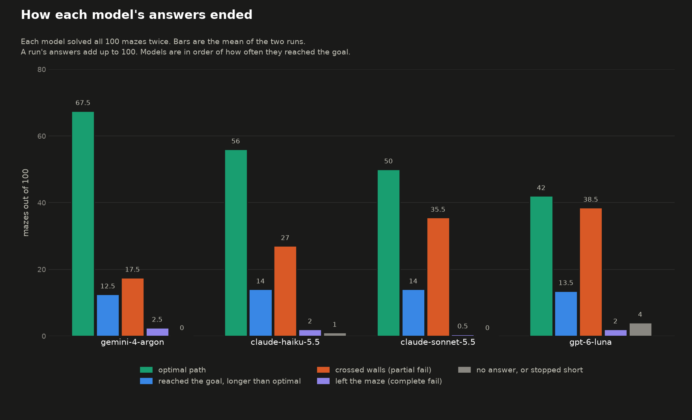
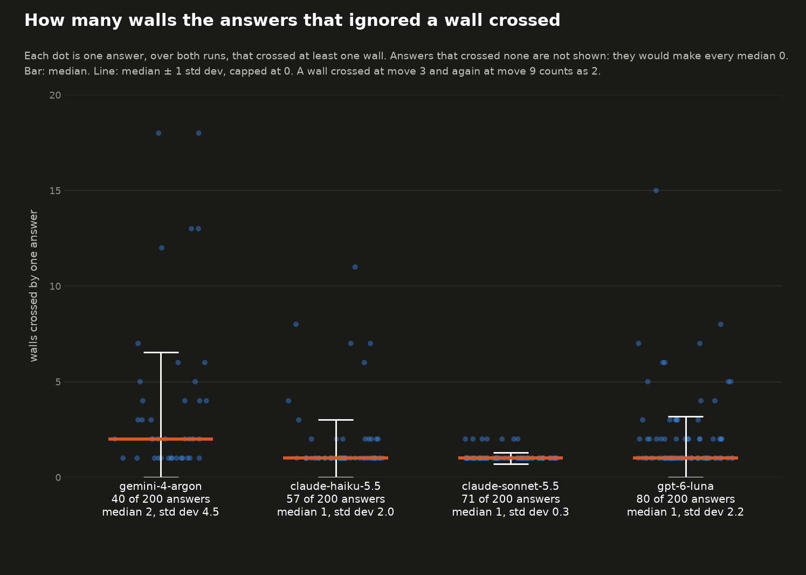
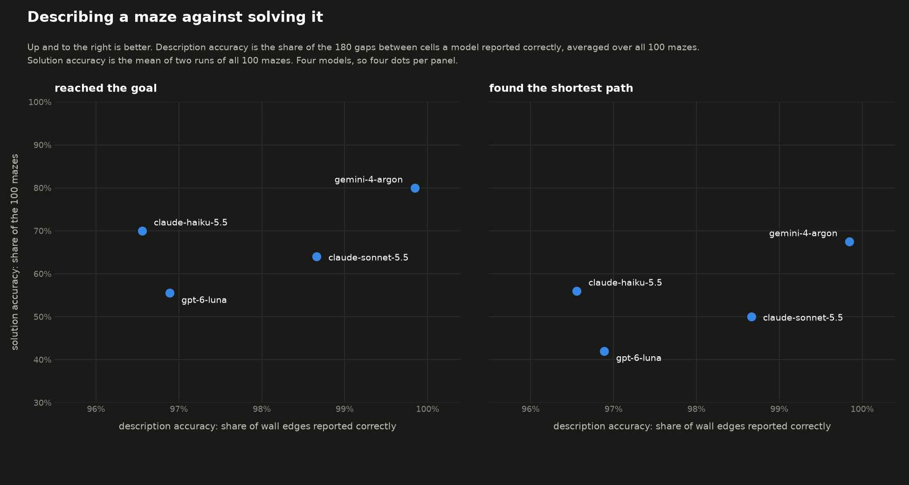
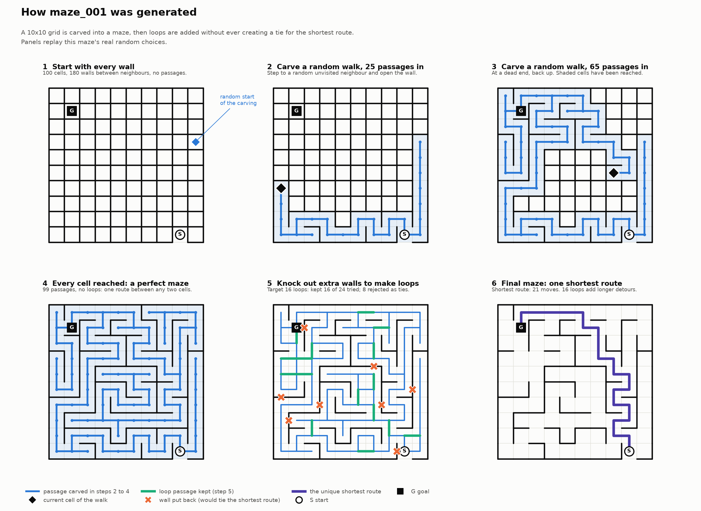

# Mazebench

Can current multimodal models read a maze from an image well enough to solve it, and when they fail, is it because they misread the image or because they plan a bad route?

Mazebench separates the two. In the **describe** task a model looks at a maze image and reports where the start, the goal and every wall are, which tests perception alone. In the **solve** task it answers with a move string (`U`, `D`, `L`, `R`) from the start to the goal, which needs perception and planning together. Every answer is graded against the true maze, and all calls go through [OpenRouter](https://openrouter.ai).

The full design, with the model selection rules and the planned (not yet run) steps, is in [experiments.md](experiments.md).

## Results

**Solving all 100 mazes from the image**, two runs per model (the figures are run 1 / run 2). "Reached the goal" counts any legal path to the goal; "optimal" is the shortest path.

| Model | Reached the goal | Optimal | Cost per run | Seconds per maze |
|---|---:|---:|---:|---:|
| `google/gemini-4-argon` | 84 / 76 | 67 / 68 | $3.09 / $2.64 | 37 / 32 |
| `anthropic/claude-haiku-5.5` | 71 / 69 | 58 / 54 | $0.25 / $0.29 | 23 / 26 |
| `anthropic/claude-sonnet-5.5` | 66 / 62 | 49 / 51 | $2.65 / $2.78 | 19 / 20 |
| `openai/gpt-6-luna` | 57 / 54 | 41 / 43 | $0.45 / $0.44 | 100 / 91 |



Most failures are paths that cross walls. For Sonnet, 29 of its 34 first-run failures cross exactly one wall and would otherwise end on the goal. Argon's failures are less often near misses: 9 of its 16 first-run failures and 17 of its 24 second-run failures ignore two or more walls. Counts for every outcome are in [charts/solve_chart_data.csv](charts/solve_chart_data.csv).

Across both runs, an answer that crossed any wall crossed a median of 1 wall for Sonnet, Haiku and Luna and 2 for Argon, but the spread differs a lot. Sonnet's answers cross 1 or 2 walls (std dev 0.3). Argon's range from 1 to 18 (std dev 4.5), so it crosses fewer walls less often but many more when it does.



The chart counts only answers that crossed at least one wall (40 of Argon's 200, 57 of Haiku's, 71 of Sonnet's and 80 of Luna's), because most answers cross none and a median over all answers would be 0 for every model. The numbers are in [charts/solve_walls_data.csv](charts/solve_walls_data.csv).

**Describing all 100 mazes**, wall edge accuracy is the share of the 180 gaps between cells reported correctly. A model that reports no walls at all scores about 62%.

| Model | Wall edge accuracy | Wall recall | Wall precision | Start / goal found | Exact descriptions |
|---|---:|---:|---:|---:|---:|
| `google/gemini-4-argon` | 99.8% | 99.8% | 99.8% | 100 / 100 | 77 |
| `anthropic/claude-sonnet-5.5` | 98.7% | 97.2% | 99.3% | 100 / 100 | 18 |
| `openai/gpt-6-luna` | 96.9% | 95.8% | 96.4% | 97 / 97 | 6 |
| `anthropic/claude-haiku-5.5` | 96.6% | 95.1% | 96.3% | 100 / 100 | 10 |
| `qwen/qwen3.8-max-0902` | 95.1% | 92.8% | 94.5% | 99 / 99 | 7 |

Describing well does not predict solving well: Haiku describes worse than Sonnet and Luna but solves more mazes than either.



**Model selection, first 20 mazes.** Thirteen models described the first 20 mazes; the five best went on to all 100.

| Model | Wall edge accuracy | Wall recall | Wall precision | Exact descriptions |
|---|---:|---:|---:|---:|
| `google/gemini-4-argon` | 99.9% | 99.6% | 100.0% | 16 |
| `anthropic/claude-sonnet-5.5` | 98.7% | 97.4% | 99.1% | 5 |
| `openai/gpt-6-luna` | 98.1% | 97.1% | 97.9% | 3 |
| `anthropic/claude-haiku-5.5` | 97.3% | 96.2% | 96.8% | 3 |
| `qwen/qwen3.8-max-0902` | 96.6% | 94.8% | 95.8% | 4 |
| `google/gemini-3.8-flash` | 94.3% | 90.7% | 93.6% | 1 |
| `minimax/minimax-m3.1-flash` (free tier) | 89.2% | 87.9% | 84.2% | 0 |
| `meta/muse-spark-1.3` | 80.6% | 71.1% | 75.7% | 0 |
| `z-ai/glm-5.3-flash` (low effort) | 70.5% | 52.4% | 62.4% | 0 |
| `mistralai/mistral-large-4-0` (19 mazes scored) | 63.9% | 52.8% | 52.2% | 0 |
| `deepseek/deepseek-v4.1-flash` | 60.4% | 28.1% | 43.5% | 0 |
| `nvidia/nemotron-3.5-super-vl` | 60.2% | 46.0% | 46.8% | 0 |
| `xiaomi/mimo-v2.6-pro` | 54.9% | 51.4% | 42.4% | 0 |

More charts are in [charts/](charts/): start and goal accuracy, wall recall and precision with spread across mazes, accuracy against cost and against time (each for the 20-maze set, and for the 100-maze set with a `_100` suffix), and wall edge accuracy per maze for the first 20. The numbers behind every chart are in the CSV files next to them. Costs are in [results/costs.md](results/costs.md).

### Caveats

- **Noise.** Each model solved each maze twice, and the two runs disagree on about a fifth of the mazes, so differences of a few points are within noise. The Haiku and Sonnet ordering in particular is not settled by these runs.
- **Reasoning effort was not controlled.** Models ran at their provider's default effort, which differs: OpenRouter lists Sonnet 5.5 at `high`, Haiku 5.5 and Luna at `medium`, and Argon at `medium`; Qwen3.8 Max has reasoning always on, with `xhigh` as its default. GLM models run at low effort because at the default they never finish. Costs and times include that reasoning.
- **Time is wall-clock latency** with several requests in flight, through whichever provider OpenRouter picked, so it reflects load as well as the model.
- **Kimi K3 and Grok 4.7** are in `models_last_6_months.csv` but were only piloted on 3 mazes, so their results are not included. The main reason was that these models were pretty expensive.
- **Qwen was not run on the solve task.** It was only tried on one maze; a full run was estimated at $6 to $12.
- **Steps 5 and 6** in `experiments.md` (text mazes, a navigation tool) are planned and not run.
- **Imported descriptions.** `results/anthropic_claude-sonnet-5.5.describe.imported.*.json` holds Sonnet descriptions produced by an agent reading the images outside this pipeline (see `import_descriptions.py` and `results/raw/`). It is a reference point, not a like-for-like result, and no chart uses it.

## The maze set

100 mazes on a 10x10 grid, generated once with a fixed seed (`generate.py`) and used for every experiment. Each maze has exactly one shortest route from start to goal; 85 of the 100 also contain loops, so a model can reach the goal by a longer route. The entry is a gap in the outer wall (25 mazes per side) and the goal is a random cell. Images are 640x640 pixels: green start cell, red goal cell, thick black walls, thin gray cell grid. `mazes/mazes.json` holds the answer key for every maze (layout, start, goal, shortest path), with cells addressed `(row, col)` from the top left.



## Repository layout

| Path | What it is |
|---|---|
| `generate.py` | Generates the 100 mazes into `mazes/` (images and `mazes.json`) |
| `visualize_generation.py` | Draws the generation steps for one maze (`generation_steps.png`) |
| `list_models.py` | Lists recent OpenRouter models; wrote `models_last_6_months.csv` |
| `describe.py` | Runs the describe task for a model and grades it |
| `solve.py` | Runs the solve task for a model and grades it; also counts the walls an answer ignored |
| `import_descriptions.py` | Grades descriptions produced outside `describe.py` and stores them as a result file |
| `make_charts.py` | Charts for the describe results (20-maze and 100-maze sets) |
| `make_solve_charts.py` | Charts for the solve results and the describe against solve comparison |
| `mazes/` | The maze images and answer key |
| `results/` | One JSON file per model and task, plus `costs.md` |
| `charts/` | Generated charts and the CSV files behind them |
| `experiments.md` | The experiment design |

## Running it

The dependencies (matplotlib and Pillow) are listed in `pyproject.toml`: `uv sync` installs them, or run `pip install matplotlib pillow`. The scripts that call models use only the standard library. Tested with Python 3.13.

```sh
python3 generate.py                      # only needed to regenerate the mazes; the seed makes it reproducible

export OPENROUTER_KEY=...                # OPENROUTER_API_KEY also works
python3 describe.py --model google/gemini-4-argon --workers 8
python3 solve.py --model google/gemini-4-argon --workers 8
python3 solve.py --model z-ai/glm-5.3 --input ascii    # text maze, for text-only models
python3 solve.py --limit 5               # a few mazes first; --ids and --start also select mazes
python3 solve.py --show maze_001         # print the text prompt for a maze

python3 make_charts.py                   # charts/ for the describe results
python3 make_solve_charts.py             # charts/ for the solve results
```

Every `describe.py` or `solve.py` run writes a new file, `results/<model>.describe.<timestamp>.json` or `results/<model>.image.<timestamp>.json`, and never touches an existing one. Calls that fail on the network or at the provider are retried and not graded. Runs cost money: a full 100-maze run of the models above cost between about $0.2 (Haiku or Luna describing) and $7 (Qwen describing); see `results/costs.md`. Reasoning models can be much more expensive per maze.

### Result files

The result files kept here are:

- `results/<model>.describe.json`: the description run for one model. For the five models that described all 100 mazes this is the 20-maze run and the 80-maze run merged into one file; the other eight models cover mazes 1 to 20.
- `results/<model>.image.run1.json` and `run2.json`: two full passes of the solve task.

The chart scripts read exactly these names, so to chart a new run, merge or rename its file to match. Each record holds the maze `id`, `status`, `note`, the model's `response` and `reasoning` text, `usage` (tokens and billed `cost`), `seconds`, `provider`, `served_model` and `run_at`. Describe records add `description` and `scores` (`start_ok`, `goal_ok`, `edge_accuracy`, `wall_recall`, `wall_precision`, `exact`). Solve records add `moves`, `optimal_length`, and the wall fields `walls_ignored`, `wall_moves` and `reaches_goal_ignoring_walls`.

### How answers are graded

- **Describe:** the reported start and goal cell must match exactly. The walls are two 0/1 grids covering all 180 gaps between neighbouring cells; the score is the share of gaps reported correctly, plus recall and precision over the real walls. Missing or malformed parts count as wrong.
- **Solve:** the move string is walked through the true maze. `optimal` means every move was legal, it ended on the goal and it used the minimum number of moves; `solved` means it reached the goal by a longer path; `failed` means it crossed a wall, left the grid, stopped short or gave no answer. A failed answer is still walked to the end as if walls were passable, and the number of walls it crossed is stored in `walls_ignored`, so a path that is wrong by a single wall can be told apart from one that ignores many.
